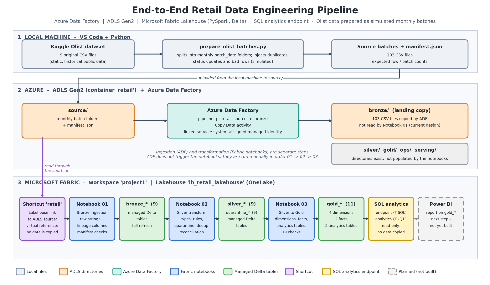
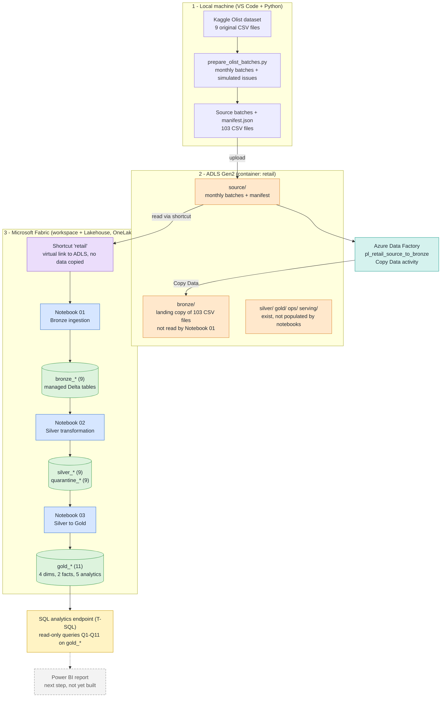

# End-to-End Retail Data Engineering Pipeline on Azure and Microsoft Fabric

A batch data-engineering project that takes the public **Olist Brazilian e-commerce dataset**, delivers it as simulated monthly source batches, moves it with **Azure Data Factory** into **ADLS Gen2**, and transforms it in a **Microsoft Fabric Lakehouse** with **PySpark and Delta tables** through a Bronze → Silver → Gold design. Invalid records are quarantined with their reasons, every layer is reconciled against an independent manifest, and the Gold layer is a validated star schema with five analytics tables that are queried with T-SQL on the Fabric SQL analytics endpoint.

> **Status:** ingestion, Bronze, Silver, Gold and their validation are implemented and were executed successfully (results in [`docs/validation_results.md`](docs/validation_results.md)). **SQL analytics** (T-SQL queries on the Fabric SQL analytics endpoint) is implemented and executed (results in [`docs/sql_analytics.md`](docs/sql_analytics.md)). A **Power BI report is the next step and is not yet built**. See [Known limitations](#19-known-limitations).

---

## Table of contents
1. [Business problem and objectives](#1-business-problem-and-objectives)
2. [Key features](#2-key-features)
3. [Architecture overview](#3-architecture-overview)
4. [Architecture diagram](#4-architecture-diagram)
5. [Technology stack](#5-technology-stack)
6. [Dataset source and attribution](#6-dataset-source-and-attribution)
7. [Data ingestion workflow](#7-data-ingestion-workflow)
8. [Bronze, Silver and Gold](#8-bronze-silver-and-gold)
9. [Table inventory and grain](#9-table-inventory-and-grain)
10. [Data quality and quarantine](#10-data-quality-and-quarantine)
11. [Business definitions and KPI logic](#11-business-definitions-and-kpi-logic)
12. [Validation and testing](#12-validation-and-testing)
13. [SQL analytics and key findings](#13-sql-analytics-and-key-findings)
14. [Repository structure](#14-repository-structure)
15. [Setup and execution](#15-setup-and-execution)
16. [Azure configuration prerequisites](#16-azure-configuration-prerequisites)
17. [Security and cost](#17-security-and-cost)
18. [Resume-ready description](#18-resume-ready-description)
19. [Known limitations](#19-known-limitations)
20. [Future improvements](#20-future-improvements)
21. [References](#21-references)

---

## 1. Business problem and objectives

An online marketplace wants trustworthy answers to everyday questions: *How are sales trending? Which product categories earn the most? How do customers pay? Are deliveries late, and does lateness hurt reviews? How many customers come back?*

The raw exports cannot answer these reliably. Orders arrive more than once as they change state, rows are re-delivered, some values are invalid, review text contains commas and line breaks, and one `review_id` can belong to several orders. Joining items, payments and reviews naively multiplies rows and inflates revenue.

**Objectives**
- Build a layered, repeatable batch pipeline from raw files to analytics-ready tables.
- Catch invalid data without losing it (quarantine) and without silently dropping rows.
- Prove correctness: reconcile every layer against an independent expected-count manifest.
- Model Gold tables with explicit grain so metrics cannot be inflated by join multiplication.

## 2. Key features

- **Simulated source system** – a local Python script turns static CSVs into monthly batches and a `manifest.json` of expected counts, with injected duplicates, order-status updates and bad records (clearly documented as simulated).
- **Azure Data Factory ingestion** – a Copy Data activity copies the 103 batch files from the `source/` area to a `bronze/` landing area in ADLS Gen2, authenticated with a managed identity.
- **Fabric Lakehouse shortcut** – Fabric reads the ADLS source files through a shortcut (no copy).
- **Bronze** – nine managed Delta tables holding raw string values plus lineage columns; row and file counts validated against the manifest.
- **Silver** – one reusable PySpark function applies type conversion, business-rule validation, quarantine, de-duplication on explicit business keys and row-count reconciliation to nine tables.
- **Gold** – four dimensions, two facts and five analytics tables with a stated grain each, built without join multiplication and checked by 19 assertions.
- **SQL analytics** – a set of twelve T-SQL queries (CTEs, window functions, conditional aggregation, fact-to-dimension joins); Q1–Q11 were executed on the Lakehouse SQL analytics endpoint and answer business questions on sales trend, categories, payments, repeat customers, delivery and reviews.
- **Honest documentation** – implemented features, simulated parts and limitations are stated separately.

## 3. Architecture overview

Data physically lives in two different places, and the diagram below shows both:

| # | Step | Reads | Writes | Where it physically lives |
|---|---|---|---|---|
| 1 | Local batch preparation (VS Code, Python) | Original Kaggle CSVs | Monthly batch folders + `manifest.json` | Local disk |
| 2 | Upload | Local batch files | `source/` | ADLS Gen2 container |
| 3 | Azure Data Factory – Copy Data | `source/` | `bronze/` (landing copy, 103 CSV files) | ADLS Gen2 container |
| 4 | Lakehouse shortcut `retail` | – | – (virtual reference, nothing is copied) | Appears as `Files/retail/…` in the Lakehouse |
| 5 | Notebook 01 – Bronze | `Files/retail/source/…` through the shortcut | `bronze_*` tables | Lakehouse **Tables** (OneLake) |
| 6 | Notebook 02 – Silver | `bronze_*` tables | `silver_*`, `quarantine_*` tables | Lakehouse **Tables** (OneLake) |
| 7 | Notebook 03 – Gold | `silver_*` tables | `gold_*` tables | Lakehouse **Tables** (OneLake) |
| 8 | SQL analytics endpoint (T-SQL queries) | `gold_*` tables | query results only (read-only; nothing is copied or modified) | Lakehouse SQL analytics endpoint |
| 9 | Power BI report | `gold_*` tables | – | *Next step, not yet built* |

Two points matter for accuracy:

- **The storage directories and the Delta tables are different things.** The `bronze/` directory in ADLS is a file landing area filled by Azure Data Factory. The `bronze_*`, `silver_*` and `gold_*` tables are managed Delta tables created by the Fabric notebooks inside the Lakehouse. The notebooks do not write to the `silver/`, `gold/`, `ops/` or `serving/` directories.
- **Notebook 01 reads the `source/` area through the shortcut, not the ADF-created `bronze/` copy.** Ingestion (ADF) and transformation (Fabric notebooks) are separate steps; ADF does not run the notebooks, which are executed manually in order. See [Known limitations](#19-known-limitations).

## 4. Architecture diagram



Editable sources: [`architecture/architecture.mmd`](architecture/architecture.mmd) (Mermaid), [`architecture/make_diagram.py`](architecture/make_diagram.py) (generates the PNG and an SVG). The same flow in Mermaid, rendered by GitHub:



## 5. Technology stack

| Technology | Role in this project |
|---|---|
| Python, pandas (local) | Prepare monthly source batches and `manifest.json` from the original CSVs |
| Azure Data Lake Storage Gen2 | Storage for source batches and the ADF landing copy (hierarchical namespace, container `retail`) |
| Azure Data Factory | Copy Data pipeline `pl_retail_source_to_bronze`; linked service uses the factory's system-assigned managed identity |
| Microsoft Fabric Lakehouse / OneLake | Hosts the shortcut to ADLS and the managed Delta tables |
| Fabric notebooks, PySpark | All Bronze, Silver and Gold transformations and validation |
| Delta Lake (managed tables) | Storage format of every `bronze_*`, `silver_*`, `quarantine_*` and `gold_*` table |
| Fabric SQL analytics endpoint (T-SQL) | Read-only SQL over the Gold Delta tables; runs the analytics queries in `sql/` |
| Power BI | **Next step** – not yet built |

## 6. Dataset source and attribution

- **Dataset:** *Brazilian E-Commerce Public Dataset by Olist*, published on Kaggle: <https://www.kaggle.com/datasets/olistbr/brazilian-ecommerce>. It contains nine CSV files (orders, order items, payments, reviews, customers, products, sellers, geolocation and a category-name translation) covering roughly 100 thousand orders from 2016 to 2018.
- **Data is not included in this repository.** Download it yourself from Kaggle. Check the license and terms shown on the dataset page before using or redistributing any data derived from it.

### What is real and what is simulated

| Layer | What it is |
|---|---|
| **Original public data** | Static historical Olist CSV files. Olist is **not** a live production source. |
| **Simulation layer (this repo's script)** | `scripts/prepare_olist_batches.py` splits the data into monthly batches, makes some orders arrive twice (an early *processing* snapshot, then the final record), re-delivers some rows as duplicates, and injects a few clearly invalid rows. It also writes `manifest.json` with the expected counts. These behaviours are **simulated** to create realistic data-engineering problems; they are not features of the original data. |
| **Azure / Fabric implementation** | Everything downstream: upload, Azure Data Factory copy, Fabric Bronze/Silver/Gold notebooks and validation. |

Simulated issues (seed 42, defaults):

| Table | Injected |
|---|---|
| orders | status-update snapshots across months; ~0.5% re-delivered duplicates; 20 bad rows (missing customer, invalid status, delivery before purchase) |
| order_items | ~1% duplicates; 20 bad rows (negative price or freight) |
| order_payments | ~1% duplicates; 20 bad rows (negative value or unknown payment type) |
| order_reviews | ~1% duplicates; 20 bad rows (score outside 1–5); reviews arrive in the month they were created |
| customers | ~0.5% duplicates |
| other tables | delivered once, unchanged |

## 7. Data ingestion workflow

1. Download the Olist CSVs from Kaggle.
2. Run `scripts/prepare_olist_batches.py` locally. It writes `data/source/<table>/batch_date=YYYY-MM-DD/<table>.csv` and `data/source/manifest.json`.
3. Upload the prepared `source` folder to the `source/` directory of the ADLS Gen2 container.
4. Run the Azure Data Factory pipeline `pl_retail_source_to_bronze`. Its Copy Data activity copies the source files to the `bronze/` landing area (103 CSV files in the executed run).
5. In the Fabric Lakehouse, the shortcut `retail` points at the ADLS container, so the files appear under `Files/retail/…`.
6. Run notebooks 01, 02 and 03 in order. Each one overwrites its output tables, so reruns are safe.

## 8. Bronze, Silver and Gold

### Bronze – `nb_01_bronze_ingestion`
- Reads `Files/retail/source/<table>` (all monthly batches) for nine tables and writes `bronze_<table>` managed Delta tables.
- **Every column stays a string** and nothing is filtered, cleaned or de-duplicated. Bronze mirrors what was delivered.
- Adds `_source_file`, `_batch_date` (parsed from the `batch_date=…` folder) and `_ingested_at`.
- `order_reviews` needs `multiLine`, `quote` and `escape` options because review text can contain commas and line breaks. Without them one review splits across several rows (105,225 rows instead of the correct 100,236).
- Validates row counts, source-file counts and batch dates against `manifest.json` and stops on any mismatch.
- Full refresh (overwrite) on every run.

### Silver – `nb_02_silver_transformation`
One function, `build_silver(name, keys, rules, casts, renames)`, handles every table in four steps:

1. **Type conversion** with `try_cast`. A non-empty value that cannot be converted is recorded as a failure (`unparseable_<column>`), never silently turned into NULL.
2. **Business-rule validation.** Each rule is a SQL condition that must be true; NULL counts as a failure unless the rule explicitly allows NULL. Failing rows go to `quarantine_<table>`.
3. **De-duplication.** Among valid rows, one row per business key is kept: the one from the latest `_batch_date` (ties broken by `_source_file`). For orders this means the latest status wins.
4. **Reconciliation.** `Bronze = Silver + quarantined + removed`, Silver keys must be unique, and the final cell compares every table with the manifest.

| Table | Business key | Main conversions | Validation rules |
|---|---|---|---|
| orders | `order_id` | 5 timestamps | ids present; status in the allowed set; purchase timestamp present; delivery not before purchase |
| customers | `customer_id` | – | ids present; 2-letter state |
| order_items | `order_id`, `order_item_id` | int, timestamp, `decimal(12,2)` price and freight | ids, product and seller present; price ≥ 0; freight ≥ 0 |
| order_payments | `order_id`, `payment_sequential` | ints, `decimal(12,2)` value | order id present; type in (`credit_card`, `boleto`, `voucher`, `debit_card`, `not_defined`); value ≥ 0; instalments ≥ 0 |
| order_reviews | **`review_id`, `order_id`** | int score, 2 timestamps | ids present; score between 1 and 5 |
| products | `product_id` | 7 integer columns; misspelled `…_lenght` columns renamed | id present; weight ≥ 0 or missing |
| sellers | `seller_id` | – | id present |
| category_translation | `product_category_name` | – | both names present |
| geolocation | all five columns | latitude and longitude to double | zip prefix present; valid latitude and longitude |

> **Why reviews use `(review_id, order_id)`:** in the Olist data one `review_id` can belong to several orders. De-duplicating on `review_id` alone deleted 814 legitimate review rows in an earlier version of this project; the composite key removes only exact re-deliveries.

### Gold – `nb_03_silver_to_gold`
- Builds a star-schema-style layer: dimensions, two fact tables and five analytics tables (inventory below).
- **Avoiding join multiplication:** items, payments and reviews are never joined to each other. Each is aggregated to **order grain first** and then joined one-to-one to orders. The item fact receives only order-level attributes. Analytics tables are built from the two facts, not from raw Silver joins.
- Validates grain, uniqueness and totals with 19 assertions (see [Validation](#12-validation-and-testing)).
- Full refresh (overwrite) on every run.

## 9. Table inventory and grain

**Bronze (9)** `bronze_orders`, `bronze_customers`, `bronze_order_items`, `bronze_order_payments`, `bronze_order_reviews`, `bronze_products`, `bronze_sellers`, `bronze_geolocation`, `bronze_category_translation`
**Silver (9)** the same names with the `silver_` prefix
**Quarantine (9)** `quarantine_<table>` with `_table`, `_raw_record` (original row as JSON), `_dq_failures`, `_source_file`, `_batch_date`, `_quarantined_at`

**Gold (11)**

| Table | Type | Grain (one row per …) | Purpose |
|---|---|---|---|
| `gold_dim_date` | dimension | calendar day | date attributes (year, quarter, month, weekday, weekend flag) |
| `gold_dim_customer` | dimension | `customer_unique_id` (real person) | latest known location; the source `customer_id` changes per order |
| `gold_dim_product` | dimension | product | category in English, else Portuguese, else `unknown` |
| `gold_dim_seller` | dimension | seller | seller location |
| `gold_fact_orders` | fact | order | status, delivery metrics, item / payment / review summaries |
| `gold_fact_order_items` | fact | order item | price, freight, product, seller, customer, date |
| `gold_daily_sales` | analytics | purchase day | orders, items, GMV, freight, customers, average order value |
| `gold_payment_method_performance` | analytics | payment type | orders, payment value, share, average instalments |
| `gold_product_category_sales` | analytics | product category | units, revenue, average price, review score, late-delivery rate |
| `gold_customer_summary` | analytics | `customer_unique_id` | orders, total spent, first/last order, recency, repeat flag |
| `gold_delivery_performance` | analytics | customer state × purchase month | delivered orders, delivery days, late orders, on-time rate |

## 10. Data quality and quarantine

- **Detect, don't drop silently.** Rejected rows are written to `quarantine_<table>` with every failed rule and the original record, so they can be inspected or reprocessed.
- **Quarantine instead of failing the whole run.** A handful of bad rows should not block 100,000 good ones; the reconciliation still accounts for every row.
- **Rules are plain business logic.** None of them depends on the markers used to create test data.
- **Duplicates** are removed by business key (latest batch wins) and counted, not hidden.
- **Reconciliation** proves nothing was lost or invented: `Bronze = Silver + quarantined + removed`.
- In the executed run the quarantine counts match the injected bad rows exactly (20 per transactional table). That shows the rules catch what was planted; it does not claim the original data has no other problems.

## 11. Business definitions and KPI logic

| Term | Definition |
|---|---|
| Revenue order | An order whose status is not `canceled` or `unavailable` |
| GMV | Sum of item `price` for revenue orders. Freight is reported separately. |
| Delivered order | Status `delivered` **and** a delivery date present (8 source orders are marked delivered without a date and are treated as not delivered) |
| Late order | Delivered on a date after the estimated delivery date |
| Order review score | Score of the **latest** review of the order; `review_count` is stored too (547 orders have more than one review) |
| Product category | English name, else Portuguese name, else `unknown` |
| Repeat customer | A real customer (`customer_unique_id`) with more than one revenue order |
| Average order value | GMV divided by number of orders |

Category review scores and late-delivery rates are **item-weighted** averages of order-level values.

## 12. Validation and testing

| Layer | Check | Result |
|---|---|---|
| Bronze | Row count, source-file count and batch date per table vs. `manifest.json` | 9 of 9 tables match (103 files, 1,591,765 rows) |
| Silver | `Bronze = Silver + quarantined + removed`; unique business keys; Silver counts and quarantine counts vs. manifest | 9 of 9 tables reconcile |
| SQL analytics | Q1 and Q2–Q11 executed on the SQL analytics endpoint; Q1 totals and the sums of Q5 (payments) and Q7 (revenue) equal the Gold validation totals | consistent (see [section 13](#13-sql-analytics-and-key-findings)) |
| Gold | Grain row counts, key uniqueness, total price / payments vs. Silver, analytics totals vs. facts, dimension coverage | **19 of 19 checks pass** |

Highlights: `gold_fact_orders` has exactly 99,441 rows and `gold_fact_order_items` exactly 112,650 (no row multiplication or loss), and GMV of 13,494,400.74 is identical in the item fact, daily sales, category sales and customer summary.

Gold also reports **data observations** that are deliberately not forced to a value, for example 249 orders where payments differ from items + freight by more than 1.00. Full tables: [`docs/validation_results.md`](docs/validation_results.md).

## 13. SQL analytics and key findings

Twelve T-SQL queries (`sql/gold_analytics_queries.sql`) were written for the Lakehouse **SQL analytics endpoint**, a read-only T-SQL surface over the Gold Delta tables (nothing is copied or modified). Queries **Q1–Q11 were executed** and their outputs are recorded in [`docs/sql_analytics.md`](docs/sql_analytics.md). Q0, a row-count sanity query, is part of the file; its output was not recorded.


| Query | Business question | Result |
|---|---|---|
| Q1 | Headline KPIs | GMV 13,494,400.74; freight 2,241,126.29; 98,199 revenue orders; 94,983 customers; average order value 137.42; 96,470 delivered orders; **93.23% delivered on time** |
| Q2 | Monthly sales trend | GMV grew from 120,098.27 (Jan 2017) to a peak of 1,003,862.14 in Nov 2017 (+52.1% on Oct), fell 26.1% in Dec 2017, then stayed around 0.85–1.0 million per month in Jan–Aug 2018 |
| Q3 / Q4 | Top categories and concentration | `health_beauty` (9.31%), `watches_gifts` (8.88%) and `bed_bath_table` (7.68%) lead; **18 of 74 categories (24%) generate 81.26% of revenue** |
| Q5 | Payment mix | Credit card 78.47% of payment value (3.51 instalments on average), boleto 17.96%, voucher 2.22%, debit card 1.35% |
| Q6 | Repeat customers | Only **2,887 of 94,983 customers (3.04%)** order more than once; they account for 5.56% of revenue |
| Q7 | Recency | 10.0% of customers bought in the last 90 days of the data; 29.4% last bought more than 365 days earlier |
| Q8 | Weakest states for delivery | `MA` is lowest at 82.57% on time (717 delivered orders), then `CE` 86.24%, `BA` 87.84%, `RJ` 87.89% (12,350 delivered orders) |
| Q9 | Lateness vs. reviews | Average review score falls from 4.32 (8+ days early) to **1.70 (8+ days late)**; the share of low scores (1–2) rises from 8.97% to 79.29% |
| Q10 | On-time trend | Dips to 87.60% (Nov 2017), 85.87% (Feb 2018) and 81.04% (Mar 2018); other months range from 92.5% to 99.3% |
| Q11 | Top sellers | The top seller has 229,237.63 GMV from 1,131 orders; the top 10 sellers make up about 13.2% of GMV and 9 of them are in `SP` |

Cross-checks between independent outputs: Q5 payment values sum to 15,739,137.01, and Q2 monthly GMV and Q7 segment revenue each sum to 13,494,400.74, the same totals as the Gold validation checks.

These are observations about a historical, partly simulated dataset; they describe the data and do not establish causes. Recency is measured from the last order date in the data, and review scores are the latest review per order.

## 14. Repository structure

```
.
├── README.md
├── requirements.txt
├── architecture/
│   ├── architecture.png        # rendered diagram
│   ├── architecture.svg
│   ├── architecture.mmd        # Mermaid source
│   └── make_diagram.py         # Generates the PNG/SVG
├── notebooks/
│   ├── nb_01_bronze_ingestion.ipynb
│   ├── nb_02_silver_transformation.ipynb
│   └── nb_03_silver_to_gold.ipynb
├── scripts/
│   └── prepare_olist_batches.py
├── sql/
│   └── gold_analytics_queries.sql
├── docs/
│   ├── validation_results.md
│   └── sql_analytics.md
├── screenshots/
│   
└── data/                       # git-ignored (raw and generated data are never committed)
    └── .gitkeep
```

## 15. Setup and execution

**Local preparation**
```bash
pip install -r requirements.txt
# put the 9 original Olist CSV files into data/raw/
python scripts/prepare_olist_batches.py --input-dir data/raw --output-dir data/source
# optional: --seed 42 (default), --bad-rows 20 (default), --no-inject
```
The script prints the expected counts and writes `data/source/manifest.json`.

**Azure and Fabric**
1. Upload `data/source/` to the `source/` directory of your ADLS Gen2 container (use any upload method you prefer).
2. Create and run the Azure Data Factory Copy Data pipeline from `source/` to `bronze/`.
3. Create the Lakehouse shortcut named `retail` to the container, so `Files/retail/source/manifest.json` exists.
4. Import the three notebooks into the Fabric workspace and attach your Lakehouse as the default Lakehouse.
5. Run `nb_01_bronze_ingestion`, then `nb_02_silver_transformation`, then `nb_03_silver_to_gold`. Each notebook ends with a validation step that stops on failure.
6. Open the Lakehouse **SQL analytics endpoint** (click Refresh if the `gold_*` tables are not listed yet) and run the queries in `sql/gold_analytics_queries.sql` one at a time, starting with Q0.

## 16. Azure configuration prerequisites

You must create and configure your own resources; no identifiers or credentials are included here.

- An Azure subscription.
- An **ADLS Gen2** storage account with the **hierarchical namespace enabled** (required for ADLS Gen2 shortcuts) and a container, for example `retail`, with a `source/` directory (and `bronze/` for the ADF copy).
- An **Azure Data Factory** instance with a linked service to the storage account. The managed-identity approach needs a role assignment that lets the factory's identity read and write the container's data.
- A **Microsoft Fabric** workspace on a Fabric capacity, a Lakehouse, and an ADLS Gen2 **shortcut** to the container. ADLS shortcuts use a delegated credential that you configure when creating the shortcut.

## 17. Security and cost

- **No secrets in the repo.** Credentials, keys and connection strings are never stored in code or notebooks; `.gitignore` excludes data files, key files and environment files. Notebook metadata was stripped of workspace and Lakehouse identifiers before publishing.
- **Managed identity** is used for Azure Data Factory to storage access, so no storage key is needed in the pipeline. Grant only the access that is required.
- **Shortcut access** is authorized through the credential chosen when the shortcut was created; use an account with the minimum needed permissions on the container.
- **Cost.** ADLS storage, Data Factory runs and Fabric capacity consumption are billed to your subscription. This project was built on a limited promotional credit. Pause or remove the Fabric capacity and delete the resource group when you are not using it, and set a budget alert.

## 18. Resume-ready description

**End-to-End Retail Data Engineering Pipeline – Azure Data Factory, ADLS Gen2, Microsoft Fabric (PySpark, Delta Lake)**
- Built a batch pipeline for the Olist e-commerce dataset (about 1.6 million source rows, 9 tables, 103 monthly batch files): Python batch-preparation script with a reconciliation manifest, Azure Data Factory Copy Data pipeline into ADLS Gen2, and Fabric Lakehouse notebooks implementing a Bronze, Silver and Gold design on Delta tables.
- Wrote a reusable PySpark Silver framework that applies type conversion, business-rule validation, de-duplication on explicit business keys and quarantine of invalid records with rejection reasons; reconciled Bronze = Silver + quarantined + removed for all nine tables against the manifest.
- Diagnosed and fixed data-modelling defects found during validation: multi-line review CSV parsing (105,225 vs. 100,236 rows) and a de-duplication key that deleted 814 valid reviews (corrected to a composite key).
- Wrote and ran 11 analytical T-SQL queries on the Fabric SQL analytics endpoint (CTEs, window functions such as `LAG`, `RANK` and running totals, conditional aggregation, fact-to-dimension joins), covering sales trend, category concentration, payment mix, repeat customers, delivery performance and its effect on review scores; reconciled query totals with the Gold validation checks.
- Designed an 11-table Gold layer (4 dimensions, 2 facts, 5 analytics tables) with explicit grain, order-level pre-aggregation to prevent join multiplication, and 19 automated checks reconciling GMV, payments and row counts across tables.

## 19. Known limitations

- **Simulated source.** The data is a static public dataset. Monthly batches, duplicates, status updates and bad rows are generated by the preparation script; they are not behaviours of a real upstream system.
- **Two parallel copies of the source.** Azure Data Factory copies `source/` to `bronze/`, but Notebook 01 reads `source/` through the shortcut. The ADF `bronze/` landing copy is therefore not consumed by the notebooks.
- **No orchestration.** Azure Data Factory does not trigger the notebooks, and nothing is scheduled; notebooks are run manually in order.
- **No incremental processing.** Bronze, Silver and Gold are full refreshes. There is no watermark, `MERGE` or change tracking. "Latest batch wins" de-duplication works inside a full rebuild only.
- **Storage directories unused by notebooks.** `silver/`, `gold/`, `ops/` and `serving/` exist in the container but the notebooks write managed Delta tables in the Lakehouse instead.
- **Quarantine results are partly by construction.** The planted bad rows are detectable by design.
- **Item-weighted category averages** and the 249 orders whose payments differ from items + freight are reported, not corrected.
- **No Power BI report or semantic model yet.** SQL analytics results exist as query outputs only. The Q0 sanity query's output was not recorded.
- **Queries are one-off analyses.** They are not saved as views, scheduled, or exposed through a semantic model.

## 20. Future improvements

*(Not implemented.)*
- Make Notebook 01 read the ADF `bronze/` landing area so ingestion and transformation form a single chain.
- Orchestrate the three notebooks after the copy with a pipeline and add a schedule.
- Incremental processing with a watermark and Delta `MERGE`, and an operational log table for run metrics.
- A Power BI report and semantic model on the Gold tables (next step), optionally backed by SQL views on the endpoint.
- Parameterize the Copy Data pipeline per table with a configuration file.
- Automated tests for the transformation functions.

## 21. References

- Olist Brazilian E-Commerce Public Dataset (Kaggle): <https://www.kaggle.com/datasets/olistbr/brazilian-ecommerce>
- Microsoft Learn – Copy activity in Azure Data Factory: <https://learn.microsoft.com/azure/data-factory/copy-activity-overview>
- Microsoft Learn – OneLake shortcuts: <https://learn.microsoft.com/fabric/onelake/onelake-shortcuts>
- Microsoft Learn – Create an ADLS Gen2 shortcut: <https://learn.microsoft.com/fabric/onelake/create-adls-shortcut>
- Microsoft Learn – Lakehouse SQL analytics endpoint: <https://learn.microsoft.com/fabric/data-engineering/lakehouse-sql-analytics-endpoint>
- Microsoft Learn – SQL analytics endpoint metadata sync: <https://learn.microsoft.com/fabric/data-engineering/sql-analytics-endpoint-metadata-sync>
